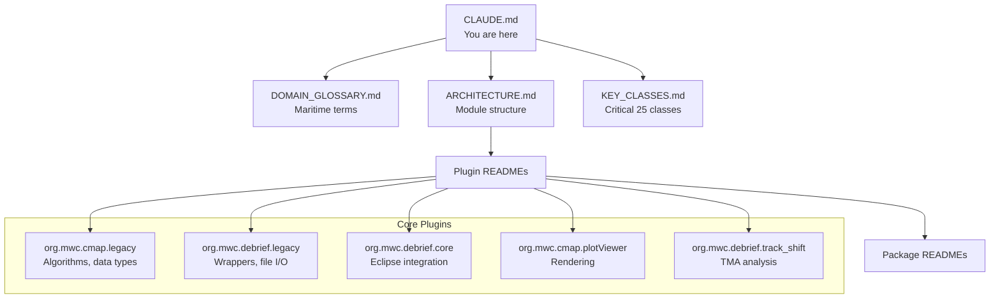

# CLAUDE.md

This file provides guidance to Claude Code (claude.ai/code) when working with code in this repository.

## Quick Navigation



## Common LLM Queries

| If you need to find... | Start here |
|------------------------|------------|
| Track/position handling | `Debrief.Wrappers.TrackWrapper`, `FixWrapper` in org.mwc.debrief.legacy |
| Sensor/bearing data | `Debrief.Wrappers.SensorWrapper`, `SensorContactWrapper` |
| TMA (Target Motion Analysis) | `org.mwc.debrief.track_shift`, `TMAWrapper` |
| Coordinate calculations | `MWC.Algorithms.Conversions`, `MWC.GenericData.WorldLocation` |
| Map projections | `MWC.Algorithms.Projections.FlatProjection`, `PlainProjection` |
| Canvas/rendering | `MWC.GUI.Canvas.*`, `MWC.GUI.Shapes.*` |
| File import (REP) | `Debrief.ReaderWriter.Replay.ImportReplay` |
| File import (XML/DPF) | `Debrief.ReaderWriter.XML.DebriefXMLReaderWriter` |
| Analysis operations | `org.mwc.debrief.core.ContextOperations.*` |
| SATC genetic algorithm | `org.mwc.debrief.satc.core` |

## Project Overview

Debrief is an Eclipse RCP (Rich Client Platform) maritime analysis application. Built with Tycho/Maven for building Eclipse plugins and features. Java 21 for build and runtime, built with Tycho 5.

### Two-Layer Architecture

```
┌─────────────────────────────────────────────────────────────┐
│  Eclipse RCP Layer (org.mwc.debrief.core, etc.)             │
│  - Views, editors, context operations                       │
│  - Extension points, OSGi bundles                           │
│  - OUT OF SCOPE for algorithm porting                       │
└───────────────────────┬─────────────────────────────────────┘
                        │ calls
┌───────────────────────▼─────────────────────────────────────┐
│  Legacy Layer (MWC.*, Debrief.*)                            │
│  - Pure Java, no Eclipse dependencies                       │
│  - Domain model, algorithms, file I/O                       │
│  - PRIMARY FOCUS for Future Debrief porting                 │
└─────────────────────────────────────────────────────────────┘
```

## Branches

Branch from `develop` and open pull requests against `develop` (the default branch). `master` is not a PR target; it only receives merges from `develop` and release branches.

## Build Commands

```bash
# Full build
mvn clean install

# Build without tests
mvn clean install -DskipTests

# Build specific module (thirdparty first: it fetches the third-party jars)
mvn clean install -pl org.mwc.debrief.thirdparty,org.mwc.debrief.core

# Run one plugin's tests (thirdparty first, then the plugins it needs)
mvn verify -pl org.mwc.debrief.thirdparty,org.mwc.cmap.jfreechart,org.mwc.cmap.legacy
```

Third-party jars that are on Maven Central are not committed: `org.mwc.debrief.thirdparty` (first in the reactor) copies them into each plugin folder under version-free names such as `pdfbox.jar`, and they are git-ignored. After a fresh clone, and before building one plugin or opening the projects in Eclipse, run `mvn -pl org.mwc.debrief.thirdparty generate-resources`. To change a version, edit that module's `pom.xml` only. GeoTools is fetched the same way by `org.mwc.cmap.geotools.libs` (from repo.osgeo.org) into `org.mwc.cmap.geotools`; after adding or dropping a GeoTools jar, run `.github/scripts/geotools_manifest.py`. See [docs/dependencies/maven-jars.md](docs/dependencies/maven-jars.md).

Keep library jars named on a plugin's `Bundle-ClassPath` at the bundle root, not in a subfolder such as `libs/`. Tycho turns each one into a dependency whose classifier is its path, and Maven 3.10 rejects a classifier containing `/` (`Invalid Collect Request: null`).

Build with **JDK 21** and **Maven 3.9 or later**: Tycho 5 needs both. Bundles declare `JavaSE-21`; Tycho compiles with `<release>21</release>` and the Ant `<javac>` tasks set `release="21"`.

## Test Architecture

Tests use **JUnit 6 (Jupiter)**: `@Test`, `org.junit.jupiter.api.Assertions` (message last). There is no JUnit 4 or hamcrest, except in the test runtime of `org.mwc.debrief.ui.test`, because SWTBot requires them.

- **Plugin tests**: each plugin keeps its tests in a `test/` folder beside `src/`, in the same packages as the code they test (so package-private members are visible). `maven-surefire-plugin`, configured in the root `pom.xml`, runs every `*Test`, `*_Test` and `Test*` class in each plugin's `test` phase, with the plugin's OSGi classpath that Tycho computes, under `-DbuildMode=true` (which suppresses dialogs). JUnit is a test-scope dependency only: production bundles and Lite don't contain it. A test needing the Eclipse runtime belongs in an `eclipse-test-plugin` such as `org.mwc.debrief.editable.test`, which Tycho Surefire runs in an OSGi UI harness.
- **Test support in production code**: `Editable.editableTesterSupport` and `WatchableList.TestWatchables` are shared by tests in several plugins, so they stay in production code and check with `MWC.Utilities.Errors.Testing.Checks` (plain `AssertionError`), not JUnit. The golden-file helpers (`Debrief.Testing.GoldenFile`, `GoldenImage`) do the same.
- **Lite headless tests**: `org.mwc.debrief.lite/src/test/java` (every `*Test` outside `tests/`), run by Ant's `<junitlauncher>` in every build (skipped with `-DskipTests`) with `java.awt.headless=true`: file round-trips, time stepping and the tote, plot state, shape insertion with undo/redo, map and projection checks. They drive Lite's own non-UI code (`org.mwc.debrief.lite.util.PlotFiles`, `PlotState`, `LiteTote`, `LiteStepControl`, the shape actions). Lite's tests compile apart from `debrief_lite.jar`, against JUnit jars that `org.mwc.debrief.thirdparty` fetches into `org.mwc.debrief.lite/test-libs/`.
- **Lite UI tests**: Swing tests in `org.mwc.debrief.lite/src/test/java/org/mwc/debrief/lite/tests/`, run by `<junitlauncher>` only with `-DliteUiTests=true` (CI's separate `lite-ui-tests` job does this under xvfb). The main build also produces `org.mwc.debrief.lite/dist/debrief-lite-<version>.zip`.

- **Debrief NG UI tests**: SWTBot tests of the RCP product's workbench in `org.mwc.debrief.ui.test` (an `eclipse-test-plugin`), only in the build with `-DrcpUiTests=true` and under a display; CI's `rcp-ui-tests` job runs them under xvfb. They cover the seven scenarios in [docs/testing/rcp-ui-suite-plan.md](docs/testing/rcp-ui-suite-plan.md): opening a plot, a screenshot of the plot editor's map (`rcp/*.png` golden images), REP import, time stepping, the tote, hide and undo, and sensor import. Shared steps are in `DebriefBot`. SWTBot needs JUnit 4 and hamcrest in that plugin's test runtime (nothing shipped includes them), so its pom names the `junit6` provider.

What the UI tests don't cover yet is in the manual checklist, [docs/testing/debrief-ng-smoke-checklist.md](docs/testing/debrief-ng-smoke-checklist.md).

## Project Structure

Key module namespaces:
- `org.mwc.debrief.*` - Main Debrief application plugins
- `org.mwc.cmap.*` - Core mapping/charting framework
- `org.mwc.asset.*` - ASSET simulation framework
- `MWC.*` - Legacy core utilities (in org.mwc.cmap.legacy)
- `Debrief.*` - Legacy Debrief code (in org.mwc.debrief.legacy)

### Core Plugins (Priority Order)

| Plugin | Purpose | Priority |
|--------|---------|----------|
| `org.mwc.cmap.legacy` | Algorithms, data types, canvas, shapes | HIGH - algorithms + rendering |
| `org.mwc.debrief.legacy` | Track wrappers, file I/O, domain model | HIGH - domain model |
| `org.mwc.debrief.track_shift` | TMA and bearing analysis | HIGH - algorithms |
| `org.mwc.cmap.plotViewer` | Plot/chart rendering | HIGH - spatial rendering |
| `org.mwc.debrief.core` | Eclipse integration, context operations | MEDIUM - entry points |
| `org.mwc.debrief.satc.core` | SATC genetic algorithm | HIGH - algorithm |

## Key Domain Classes

### Domain Model (Wrappers)

| Class | Purpose |
|-------|---------|
| `TrackWrapper` | Main track container - fixes, sensors, TMA segments (by far the largest wrapper) |
| `FixWrapper` | Single position fix with time, location, course, speed |
| `SensorWrapper` | Sensor observations container |
| `SensorContactWrapper` | Individual sensor bearing/range observation |
| `TMAWrapper` | TMA solution container |

Location: `org.mwc.debrief.legacy/src/Debrief/Wrappers/`

### Core Data Types

| Class | Purpose |
|-------|---------|
| `WorldLocation` | Lat/lon/depth position (fundamental) |
| `WorldSpeed` | Speed with unit conversions |
| `WorldDistance` | Distance with unit conversions |
| `WorldArea` | Rectangular bounding region |
| `WorldVector` | Bearing + distance vector |
| `HiResDate` | Microsecond-precision timestamp |

Location: `org.mwc.cmap.legacy/src/MWC/GenericData/`

### Algorithm Classes

| Class | Purpose |
|-------|---------|
| `Conversions` | Unit/bearing/Cartesian conversions |
| `PlainProjection` | Base projection class |
| `FlatProjection` | Flat-earth projection (default) |
| `EarthModel` | Earth model interface |

Location: `org.mwc.cmap.legacy/src/MWC/Algorithms/`

### Rendering Classes

| Class | Purpose |
|-------|---------|
| `CanvasAdaptor` | Abstract canvas interface |
| `SwingCanvas` | Swing rendering implementation |
| `PlainShape` | Base shape class |
| `Layers` | Layer container/manager |

Location: `org.mwc.cmap.legacy/src/MWC/GUI/`

## File Formats

| Format | Extension | Import Class | Export |
|--------|-----------|--------------|--------|
| Replay | `.rep` | `ImportReplay` | `FormatTracks` |
| DPF/XML | `.dpf`, `.xml` | `DebriefXMLReaderWriter` | Same |
| NMEA | `.txt`, `.log` | `ImportNMEA` | - |
| GPX | `.gpx` | `GPXLoader` | `ExportGPX` |
| AIS | `.txt` | `ImportAIS` | - |

Location: `org.mwc.debrief.legacy/src/Debrief/ReaderWriter/`

## Target Platform

Eclipse target platform defined in `org.mwc.debrief.targetplatforms/eclipse-latest.target`. Based on Eclipse 2026-09 (platform 4.41) with GEF, EMF and WTP. EASE scripting was retired (debrief/debrief#5270): it had had no release since 0.9 and no longer resolved against current Eclipse without workarounds.

## Architecture Notes

- Eclipse plugin architecture with extension points for importers, editors, views
- SWT/JFace for UI, JFreeChart for plotting
- Heavy use of property sheets and Eclipse Outline view for editing
- Context operations in `org.mwc.debrief.core/src/org/mwc/debrief/core/ContextOperations/`

## Companion Documentation

| Document | Purpose |
|----------|---------|
| [DOMAIN_GLOSSARY.md](DOMAIN_GLOSSARY.md) | Maritime analysis terminology (TMA, fixes, bearings, tracks, sensors) |
| [ARCHITECTURE.md](ARCHITECTURE.md) | Module dependencies, data flow, plugin relationships |
| [KEY_CLASSES.md](KEY_CLASSES.md) | The 25 critical classes with roles and relationships |
| [RELEASING.md](RELEASING.md) | How to cut a release: version bumping, the release tag, recovery |
| [docs/dependencies/plan.md](docs/dependencies/plan.md) | Third-party library plan: scanning, security bumps, move to Maven |

Each core plugin and key package also has a README.md with detailed documentation.
